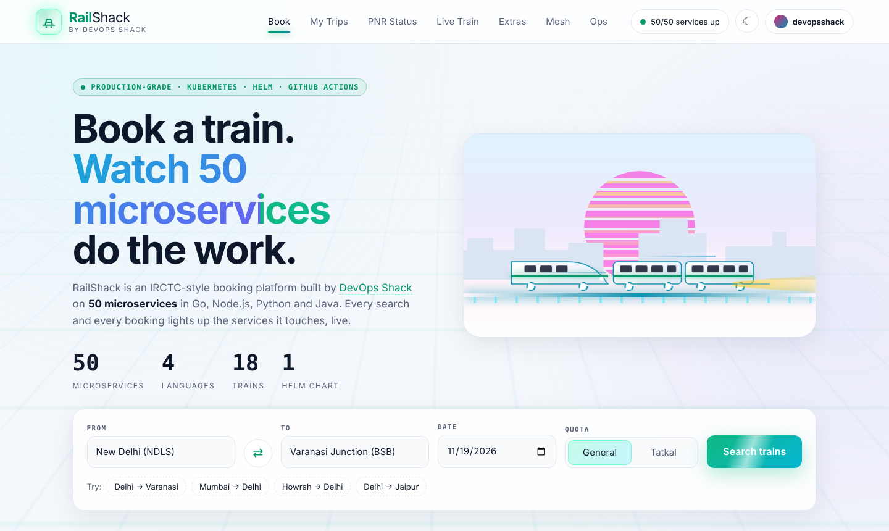
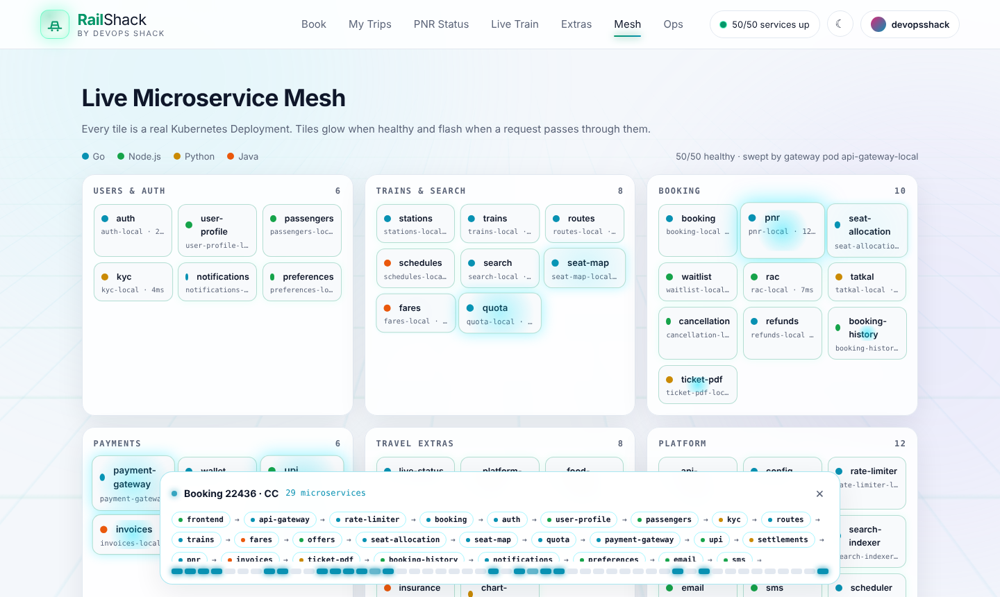
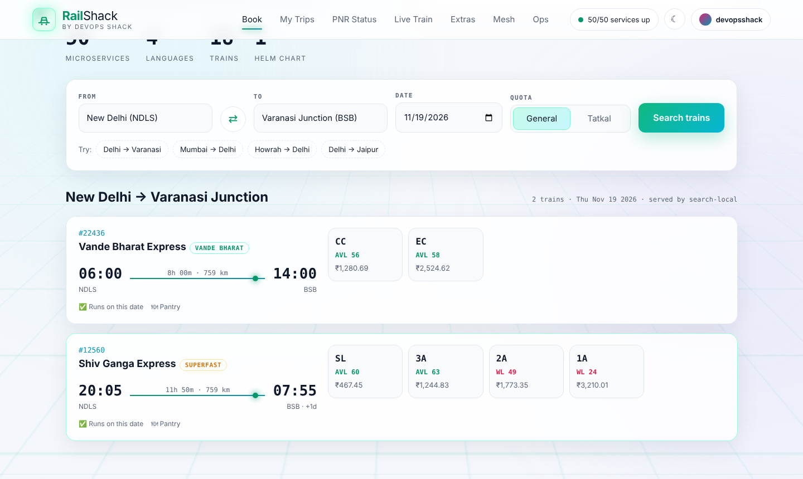
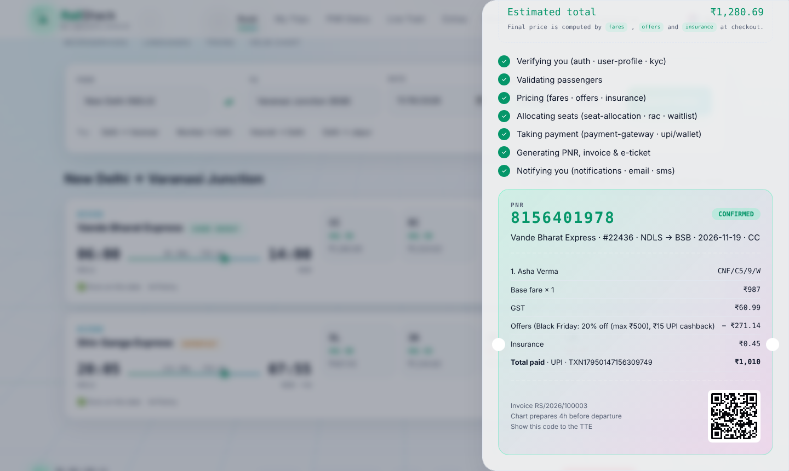
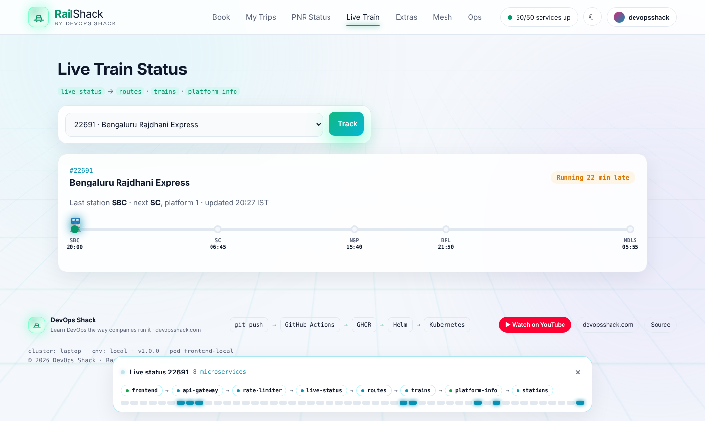
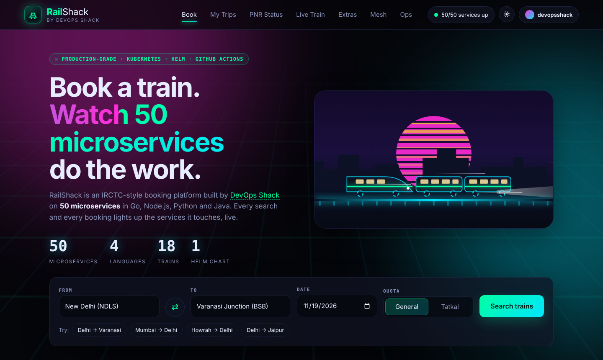
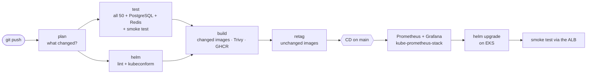

<!--
  RailShack · 50 Microservices Project by DevOps Shack
  Copyright (c) 2026 DevOps Shack (Aditya Jaiswal) · https://devopsshack.com · https://www.youtube.com/@devopsshack
  SPDX-License-Identifier: Apache-2.0 · Keep this notice and the NOTICE file in any copy or derivative work.
-->

<p align="center">
  <a href="https://www.youtube.com/@devopsshack">
    
  </a>
</p>

<p align="center">
  <a href="https://www.youtube.com/@devopsshack"></a>
  <a href="https://devopsshack.com"></a>
  <a href="LICENSE"></a>
</p>

<p align="center">
  <a href="../../actions/workflows/ci.yml"></a>
  
  
  
  
  
  
  
  
  
  
</p>

<h3 align="center">An IRCTC-style train booking platform, built on 50 microservices, deployed to AWS EKS with one Helm chart and shipped by GitHub Actions.</h3>

<p align="center">
  <b>Created by <a href="https://devopsshack.com">DevOps Shack</a></b> · Watch the full build and deployment on
  <a href="https://www.youtube.com/@devopsshack"><b>YouTube ▶</b></a>
</p>

---

## 📸 See it in action

<table>
  <tr>
    <td width="50%"><p align="center"><b>Home</b> — search trains across 20 stations</p></td>
    <td width="50%"><p align="center"><b>Live mesh</b> — one booking lights up 29 services</p></td>
  </tr>
  <tr>
    <td width="50%"><p align="center"><b>Search</b> — live availability and fares</p></td>
    <td width="50%"><p align="center"><b>Book</b> — PNR, e-ticket and invoice</p></td>
  </tr>
  <tr>
    <td width="50%"><p align="center"><b>Live train status</b> — where is my train, right now</p></td>
    <td width="50%"><p align="center"><b>Light and dark themes</b> — one click in the top bar</p></td>
  </tr>
</table>

---

## 📚 Contents

- [What is RailShack?](#-what-is-railshack)
- [Architecture](#-architecture)
- [Data: PostgreSQL + Redis cache](#-data-postgresql--redis-cache)
- [Monitoring: Prometheus + Grafana](#-monitoring-prometheus--grafana)
- [The 50 microservices](#-the-50-microservices)
- [Deploy to AWS EKS](#-deploy-to-aws-eks)
- [The Helm chart](#-the-helm-chart)
- [CI/CD with GitHub Actions](#-cicd-with-github-actions)
- [Black Friday load test](#-black-friday-load-test)
- [Project structure](#-project-structure)
- [Learn with DevOps Shack](#-learn-with-devops-shack)
- [License and attribution](#-license-and-attribution)

---

## 🚆 What is RailShack?

RailShack is a complete train booking platform, the kind you would find at a real company: search trains, check seat availability, book for up to 6 passengers, pay by UPI, wallet or card, get a 10-digit PNR and an e-ticket, track your train live, and cancel for a refund.

Behind that UI are **50 microservices in four languages**, split into six domains the way a product company splits them between teams. One booking flows through about 30 of them, and the UI lights up every service a request touches, live.

| | |
|---|---|
| **Services** | 50 — 22 Go · 18 Node.js · 6 Python · 4 Java |
| **Data** | PostgreSQL (the source of truth) + Redis (a cache in front of it) |
| **Dependencies** | Zero third-party packages. Every service uses only its language's standard library, even the PostgreSQL and Redis clients |
| **Images** | One Dockerfile per service · distroless / alpine · non-root · multi-arch (amd64 + arm64) |
| **Deployment** | One Helm chart on AWS EKS Auto Mode, reached through an Application Load Balancer |
| **CI** | Test all 50 → validate Helm → build only what changed → Trivy scan → push to GHCR |
| **CD** | Helm to EKS with OIDC (no AWS keys stored), atomic rollback, post-deploy smoke test |
| **Monitoring** | Prometheus scrapes all 50 services, PostgreSQL and Redis; four ready-made Grafana dashboards and 11 alert rules |
| **Load test** | k6 "Black Friday" sale that scales EKS from a few nodes to ~100 |

Every service, in every language, follows the same production contract:

- `/healthz` and `/readyz` for Kubernetes probes
- `/metrics` in Prometheus format
- one JSON log line per request, with a request ID you can follow across services
- configuration only from environment variables
- timeouts on every downstream call, and graceful shutdown on `SIGTERM`
- an `X-Trace` header listing every service the request touched

### 🔐 Accounts and login

Like IRCTC, browsing is open and anything personal needs an account.

| Open to everyone | Needs a signed-in account |
|---|---|
| Search trains · live train status · PNR status · station autocomplete · food menu, retiring rooms, cabs, holiday packages | **Book a ticket** · **My Trips** (only your own) · **Cancel a ticket** (only your own) |

- **Sign up / sign in** in the web app. `auth` stores each account in PostgreSQL (table `users`) with only a salted PBKDF2-SHA256 hash of the password, so every auth replica sees the same users.
- `auth` issues a signed token. The browser sends it as `Authorization: Bearer <token>`, and `api-gateway` passes it through.
- `booking`, `booking-history` and `cancellation` each ask `auth` who the token belongs to: no token gives **401**, someone else's trips or ticket gives **403**.
- The token signing key comes from a Kubernetes Secret (`railshack-auth`) that Helm generates once and keeps on upgrades. Set `auth.secret` to choose your own.
- A demo account is ready for live sessions: **`devopsshack` / `devopsshack`** (change it with the `DEMO_PASSWORD` env var on `auth`).

---

## 🏗 Architecture

<p align="center"></p>

Users reach the app through an **AWS Application Load Balancer** that EKS Auto Mode creates for us. The browser only talks to `frontend`, and every API call goes through `api-gateway`, which routes `/api/{service}/*` to the right service at `http://{service}:8080`. Below the line: how a `git push` becomes a Helm deployment.

### Every service-to-service call

<p align="center"></p>

Solid arrows are synchronous HTTP calls (the caller waits). Dashed arrows are fire-and-forget: audit, analytics and notifications can fail without failing the booking. Red dotted arrows are Redis.

<details>
<summary><b>Example: everything <code>booking</code> touches</b></summary>
<br/>
<p align="center"></p>
</details>

> The diagrams are drawn from the real calls in the code, listed in [`docs/architecture/edges.json`](docs/architecture/edges.json) (caller, callee, method, path and why).

---

## 🗄 Data: PostgreSQL + Redis cache

**PostgreSQL remembers, Redis remembers fast.** PostgreSQL is the source of truth: data is written there first and kept on a persistent EBS disk. Redis sits in front as a cache, so most reads never touch the database.

| Service | PostgreSQL table (source of truth) | Redis cache |
|---|---|---|
| `auth` | `users`: username, name, salted password hash | — (sign-in is rare, no cache needed) |
| `pnr` | `bookings`: every booking, keyed by PNR | `pnr:<pnr>` for 10 minutes |
| `booking-history` | `trips`: each user's trips (My Trips) | `trips:<user>` for 5 minutes |

The pattern is **cache-aside**:

- **Read:** ask Redis first. On a hit, answer in under a millisecond. On a miss, read PostgreSQL, keep a copy in Redis, then answer.
- **Write:** change PostgreSQL first, then delete the Redis copy so nobody reads an old status (for example after a cancellation).
- **Redis wiped?** Nothing is lost. The next read comes from PostgreSQL and fills the cache again. Try it: `kubectl delete pod -l app.kubernetes.io/name=redis -n railshack`, then check a PNR.

The PNR page and My Trips show where the answer came from: ⚡ *served from Redis cache* or 🐘 *read from PostgreSQL*. The API returns the same in a `servedFrom` field.

On Kubernetes, PostgreSQL runs as a StatefulSet with a 10 GiB encrypted gp3 EBS volume (EKS Auto Mode provisions it; the chart creates the `railshack-ebs` StorageClass). Its password is generated on first install and kept in the `railshack-postgres` Secret. The volume survives restarts, upgrades and even `helm uninstall`. Redis runs as a pure cache: no disk, and when its memory is full it drops the least recently used keys.

> In production you would usually swap the in-cluster PostgreSQL for Amazon RDS and the Redis pod for Amazon ElastiCache: point `DATABASE_URL` and `REDIS_ADDR` at them and nothing else changes.

---

## 📈 Monitoring: Prometheus + Grafana

Every service publishes Prometheus metrics on `/metrics`: requests per service, method and status code, response time, and an up/down signal. CD installs the community **kube-prometheus-stack** (Prometheus + Grafana, settings in [`cluster/monitoring-values.yaml`](cluster/monitoring-values.yaml)) into the `monitoring` namespace before deploying the app.

- **Prometheus finds all 50 services by itself.** The chart creates a ServiceMonitor that matches every RailShack service, so new replicas are scraped automatically.
- **Grafana has its own URL.** `https://grafana.<your domain>` through the same ALB and certificate as the app, so there is nothing to port-forward.
- **PostgreSQL and Redis are measured too.** On EKS, a `postgres_exporter` sidecar and a `redis_exporter` sidecar publish database and cache metrics (connections, commits, rows, cache hits and misses, keys, memory) on a `metrics` port that the same ServiceMonitor scrapes.
- **Alert rules ship with the chart.** A PrometheusRule (`railshack-alerts`) fires on a service down, more than 5% errors, slow responses, PostgreSQL or Redis down, a low cache hit ratio, pods pending, crash loops and autoscalers at their maximum.
- **Four dashboards load by themselves**, in a Grafana folder called **RailShack**. Each file in [`helm/railshack/dashboards/`](helm/railshack/dashboards) becomes a ConfigMap labelled `grafana_dashboard: "1"`, and Grafana picks it up.

| Dashboard | What it answers |
|---|---|
| **Command Center** | Is everything healthy right now? Services up, success rate, traffic by status class, the booking journey step by step, health of the six business domains, a table of all 50 services (pods, req/s, error rate, response time, version), the data layer at a glance, firing alerts |
| **Service deep dive** | Pick one service: status, version, pods, traffic by status code and method, response time, error rate, CPU and memory against their request and limit, restarts, and which node each pod runs on |
| **Data layer** | Redis: hit ratio, hits vs misses, keys, memory, expired and evicted keys. PostgreSQL: connections, transactions, rows written and read, buffer cache hit, database size, disk used. And the three services that keep data |
| **Kubernetes & autoscaling** | Nodes from EKS Auto Mode by NodePool, Spot / On-Demand, instance type and zone, pending pods, CPU and memory requested, every node's age, the autoscalers, rollouts, restarts and out-of-memory kills |

During the Black Friday test, keep **Kubernetes & autoscaling** open: requests climb, the HPAs add pods, pending pods spike and the node count follows.

---

## 🧩 The 50 microservices

| Domain | Services |
|---|---|
| **Users & Auth** (6) | `auth` · `user-profile` · `passengers` · `kyc` · `notifications` · `preferences` |
| **Trains & Search** (8) | `stations` · `trains` · `routes` · `schedules` · `search` · `seat-map` · `fares` · `quota` |
| **Booking** (10) | `booking` · `pnr` · `seat-allocation` · `waitlist` · `rac` · `tatkal` · `cancellation` · `refunds` · `booking-history` · `ticket-pdf` |
| **Payments** (6) | `payment-gateway` · `wallet` · `upi` · `invoices` · `offers` · `settlements` |
| **Travel Extras** (8) | `live-status` · `platform-info` · `food-ordering` · `retiring-rooms` · `tourism` · `cab-booking` · `insurance` · `chart-preparation` |
| **Platform** (12) | `api-gateway` · `config` · `rate-limiter` · `audit-log` · `analytics` · `search-indexer` · `email` · `sms` · `scheduler` · `feedback` · `admin` · `frontend` |

[`services.json`](services.json) is the single source of truth: name, language, domain and local port for all 50.

---

## 🚀 Deploy to AWS EKS

Everything runs on **one EKS cluster** and is deployed by GitHub Actions. You need an AWS account, the `aws` CLI, `eksctl`, `kubectl` and `helm`. Every command below is **PowerShell** (Windows PowerShell 5.1 or PowerShell 7), run from the repository folder. To run the repo's `.ps1` scripts, allow local scripts once:

```powershell
Set-ExecutionPolicy -Scope CurrentUser RemoteSigned
Get-ChildItem -Recurse -Filter *.ps1 | Unblock-File     # a downloaded ZIP marks the scripts as "from the internet"
```

**0. Check your EC2 vCPU quota.** A new AWS account can usually run only 8 vCPUs, which is not enough nodes for 102 pods (they stay `Pending` with `VcpuLimitExceeded`). Ask for 32 the day before; small increases are often approved within minutes:

```powershell
aws service-quotas get-service-quota --region ap-south-1 --service-code ec2 --quota-code L-1216C47A --query Quota.Value
aws service-quotas request-service-quota-increase --region ap-south-1 --service-code ec2 --quota-code L-1216C47A --desired-value 32
```

Until it is approved, set the repository variable `REPLICAS` = `1` (one pod per service, 52 pods).

**1. Create the cluster** (about 15 minutes):

```powershell
eksctl create cluster -f cluster\eks-auto-mode.yaml
```

That one file is all the cluster needs. EKS Auto Mode already runs the pieces we would otherwise install ourselves: Karpenter for nodes, the load balancer controller (so an Ingress becomes an ALB), and the EBS CSI driver (so a PersistentVolumeClaim becomes an EBS volume). eksctl also creates the VPC with the subnet tags the load balancer needs, and adds metrics-server for the HPAs.

**Your domain in Route 53** (once). We use `prod-bat.site`: the app on `railshack.prod-bat.site`, Grafana on `grafana.railshack.prod-bat.site`. Create a hosted zone (about $0.50 a month), then enter its four name servers in the nameserver settings where you bought the domain. If the domain already has records there (email, a website), recreate them in the zone first. The switch usually takes 15–60 minutes.

```powershell
aws route53 create-hosted-zone --name prod-bat.site --caller-reference (Get-Date -Format o)
Resolve-DnsName prod-bat.site -Type NS    # shows the awsdns name servers once the switch is done
```

Keeping DNS where you bought the domain works too: you then add ACM's validation CNAMEs and the two records below as CNAMEs by hand.

**Your HTTPS certificate** (once, about 10 minutes). In **AWS Certificate Manager, in the cluster's region (`ap-south-1`)**, request a public certificate for both names, with DNS validation:

```powershell
aws acm request-certificate --region ap-south-1 --validation-method DNS `
  --domain-name railshack.prod-bat.site --subject-alternative-names grafana.railshack.prod-bat.site
```

Add the validation CNAME records that ACM shows (Route 53 has a one-click **Create records in Route 53** button; any other DNS provider works too). When the certificate says **Issued**, copy its ARN. No domain? Skip this: the app works on the ALB's own address, but Grafana then has no public URL.

**2. Let GitHub Actions deploy without storing AWS keys** (OIDC):

```powershell
.\cluster\github-oidc-aws.ps1 -GitHubRepo "your-github-user/50-MicroServices-Project-By-DevOpsShack"
```

(On Linux or macOS, `GITHUB_REPO=your-github-user/50-MicroServices-Project-By-DevOpsShack cluster/github-oidc-aws.sh` does the same.)

**3. Configure the repository** (Settings → Secrets and variables → Actions):

| Type | Name | Value |
|---|---|---|
| Secret | `AWS_ROLE_ARN` | the role ARN printed by step 2 |
| Variable | `AWS_REGION` | `ap-south-1` |
| Variable | `EKS_CLUSTER` | `railshack` |
| Variable | `APP_DOMAIN` | your domain, e.g. `railshack.prod-bat.site` (optional) |
| Variable | `ACM_CERT_ARN` | the certificate ARN from step 1 (optional, turns on HTTPS) |
| Variable | `REPLICAS` | optional: `1` runs one pod per service (52 pods), for a new AWS account with the 8-vCPU limit |
| Secret | `GHCR_PULL_TOKEN` | a classic personal access token with only `read:packages` (lets the cluster pull the private images) |

Also create a GitHub environment called `production-eks` (Settings → Environments). Add required reviewers there if you want to approve every deploy.

**The pull token.** The 50 images in GHCR stay private. CD turns `GHCR_PULL_TOKEN` into one Kubernetes pull secret, `ghcr-pull`, used by every service. Create it at GitHub → **Settings → Developer settings → Personal access tokens → Tokens (classic) → Generate new token (classic)**, tick only **read:packages**, and pick an expiry (90 days is a good default; set a reminder to renew it). Without this secret, the packages must be made public one by one.

**4. Push to `main`.** CI tests all 50 services against a real PostgreSQL and Redis, builds the images and pushes them to GHCR. CD then installs Prometheus + Grafana, runs `helm upgrade` on EKS and a smoke test through the load balancer.

**5. Point the domain at the load balancer** (once, after the first deploy):

The app and Grafana share one ALB (one IngressClass group). Once the deploy is green and the ALB is `active`, this creates or updates both Route 53 alias records, reading the address from the Ingress:

```powershell
$alb  = kubectl get ingress railshack -n railshack -o jsonpath='{.status.loadBalancer.ingress[0].hostname}'
$zone = (aws route53 list-hosted-zones-by-name --dns-name prod-bat.site --query "HostedZones[0].Id" --output text).Split("/")[-1]
$albZone = aws elbv2 describe-load-balancers --region ap-south-1 `
  --query "LoadBalancers[?DNSName=='$alb'].CanonicalHostedZoneId" --output text
$changes = @("railshack.prod-bat.site", "grafana.railshack.prod-bat.site") | ForEach-Object {
  @{ Action = "UPSERT"; ResourceRecordSet = @{ Name = $_; Type = "A"
     AliasTarget = @{ HostedZoneId = $albZone; DNSName = $alb; EvaluateTargetHealth = $false } } }
}
$f = Join-Path ([IO.Path]::GetTempPath()) "railshack-dns.json"
[IO.File]::WriteAllText($f, (@{ Changes = $changes } | ConvertTo-Json -Depth 6))
aws route53 change-resource-record-sets --hosted-zone-id $zone --change-batch "file://$f"
```

At another DNS provider, create two **CNAME** records to the same address instead. The address stays the same on later deploys; it changes only when the release is removed and reinstalled (`helm uninstall`, or a failed first deploy that `--atomic` rolls back), and then you run this again.

If `Resolve-DnsName railshack.prod-bat.site` says the name does not exist but `Resolve-DnsName railshack.prod-bat.site -Server 8.8.8.8` works, your router cached an earlier answer: wait up to 15 minutes, or switch Windows to `8.8.8.8` and run `ipconfig /flushdns` (both as administrator).

**6. Open the app and Grafana:**

- `https://railshack.prod-bat.site`: sign in with the demo account `devopsshack` / `devopsshack`, or create your own.
- `https://grafana.railshack.prod-bat.site`: user `admin`, password from the command below. Open **Dashboards → RailShack → RailShack · Command Center**.

```powershell
$b64 = kubectl get secret monitoring-grafana -n monitoring -o jsonpath='{.data.admin-password}'
[Text.Encoding]::UTF8.GetString([Convert]::FromBase64String($b64))
```

Run the end-to-end smoke test against your domain any time:

```powershell
.\scripts\smoke-test.ps1 https://railshack.prod-bat.site
```

Prometheus stays private on purpose (it has no login). We query it from Grafana's **Explore** page.

**Clean up** when you are done, so nothing keeps costing money:

```powershell
helm uninstall railshack -n railshack
helm uninstall monitoring -n monitoring
kubectl delete pvc data-postgres-0 -n railshack        # deletes the database disk
eksctl delete cluster -f cluster\eks-auto-mode.yaml --disable-nodegroup-eviction
```

Then delete the two DNS records, so they don't point at a load balancer that no longer exists. The ACM certificate is free and can stay for next time.


---

## ☸️ The Helm chart

One chart deploys all 50 services, PostgreSQL and Redis.

```powershell
helm upgrade --install railshack helm\railshack -n railshack --create-namespace `
  -f helm\railshack\values-eks.yaml `
  --set image.repository=your-github-user `
  --set image.tag=latest `
  --atomic --wait --timeout 15m
```

| Values file | For |
|---|---|
| `values.yaml` | Defaults, PostgreSQL and Redis settings, and the list of all 50 services |
| `values-eks.yaml` | EKS Auto Mode: 2 replicas per service, PDBs, ALB Ingress (app + Grafana on one ALB), the EBS StorageClass for PostgreSQL, the PostgreSQL and Redis exporters, the ServiceMonitor, the alert rules and the four Grafana dashboards |
| `values-blackfriday.yaml` | Layered on top for the sale: HPAs and CPU requests on the 14 hot-path services, a bigger PostgreSQL |

### How users reach the app

Only `frontend` is exposed; the other 49 services stay internal and are reached through `api-gateway`. With `access.mode: alb-ingress`, the chart creates an Ingress and EKS Auto Mode builds an **Application Load Balancer** for it: nothing to install. Get the address with `kubectl get ingress railshack -n railshack`.

Add a domain and HTTPS later without redesigning anything: set `access.host` and `access.alb.certificateArns` (an ACM certificate). We do not use the community ingress-nginx controller, which was retired in March 2026.

Every Deployment gets readiness and liveness probes, zero-downtime rolling updates, a non-root read-only container with all capabilities dropped, topology spread across nodes, and Prometheus annotations.

Cluster setup files are in [`cluster/`](cluster): the `eksctl` config for EKS Auto Mode, the GitHub OIDC script and the Black Friday NodePool.

---

## 🔁 CI/CD with GitHub Actions



- **[`ci.yml`](.github/workflows/ci.yml)** runs on every push and pull request. It starts all 50 services against a real PostgreSQL and Redis and runs the smoke test. It rebuilds only the images a commit touched, for amd64 and arm64, scans them with Trivy and pushes to GHCR. Then it gives the unchanged images the same commit tag, so one tag always means one complete release of all 50.
- **[`cd.yml`](.github/workflows/cd.yml)** installs Prometheus + Grafana, then deploys to EKS with `helm upgrade --atomic` when CI is green on `main`. It logs in to AWS with OIDC, rolls back automatically on failure, and runs the smoke test through the load balancer. You can also run it by hand from the Actions tab, with an image tag and the Black Friday profile.

---

## 🛍 Black Friday load test

```powershell
kubectl apply -f cluster\nodepool-blackfriday.yaml
helm upgrade --install railshack helm\railshack -n railshack `
  -f helm\railshack\values-eks.yaml -f helm\railshack\values-blackfriday.yaml `
  --set image.repository=your-github-user
kubectl create configmap k6-script -n railshack --from-file=loadtest\blackfriday.js
kubectl apply -f loadtest\k6-job.yaml   # up to 4,000 virtual shoppers from 10 k6 pods
```

Or run CD by hand from the Actions tab with **Apply the Black Friday autoscaling profile** ticked.

Watch it in Grafana: the HPAs add pods, the pods go Pending, and EKS Auto Mode adds Spot nodes, then removes them when the sale ends. Every booking in the test is written to PostgreSQL, and repeated PNR checks are answered from Redis.

---

## 🗂 Project structure

```
services/<name>/        code + Dockerfile for each of the 50 services
libs/                   shared runtimes: gokit · nodekit · pykit · javakit
services.json           the list of all 50 services
helm/railshack/         Helm chart (50 services + PostgreSQL + Redis) + values for EKS and Black Friday
.github/workflows/      ci.yml and cd.yml
cluster/                EKS Auto Mode cluster, GitHub OIDC for AWS (PowerShell + bash), Black Friday NodePool, Prometheus + Grafana values
loadtest/               k6 Black Friday load test + in-cluster Job
scripts/                smoke test (PowerShell + bash), the Dockerfile generator, CI helpers
docs/architecture/      architecture diagrams (PNG) + every service-to-service call (edges.json)
```

**Demo knobs** — set on any service through Helm (`--set services.<name>.env.<VAR>=...`):

| Variable | Effect |
|---|---|
| `WORK_FACTOR` | ~N ms of CPU per request, so autoscaling has something to react to |
| `LATENCY_MS` | Adds N ms of delay to every request |
| `FAIL_RATE` | Fails that fraction of requests, e.g. `0.3` |

---

## 🎓 Learn with DevOps Shack

<table>
  <tr>
    <td>
      <b>This project was built by DevOps Shack</b> to show how microservices, Kubernetes, Helm and CI/CD work together at production scale.
      <br/><br/>
      ▶ <b>Watch the build, the deployment and the live sessions on YouTube:</b> <a href="https://www.youtube.com/@devopsshack">youtube.com/@devopsshack</a><br/>
      🌐 <b>Courses and the DevSecOps + Cloud + AI bootcamp:</b> <a href="https://devopsshack.com">devopsshack.com</a><br/>
      ✉️ <b>Contact:</b> <a href="mailto:office@devopsshack.com">office@devopsshack.com</a>
    </td>
  </tr>
</table>

If this project helped you, ⭐ **star the repo** and **subscribe on YouTube** — it helps us keep building projects like this.

---

## 📄 License and attribution

RailShack is © 2026 **DevOps Shack (Aditya Jaiswal)** and licensed under the [Apache License 2.0](LICENSE).

You are welcome to learn from it, run it and build on it. If you redistribute it, or anything derived from it, the license requires you to:

1. keep the [`NOTICE`](NOTICE) file's attribution to DevOps Shack;
2. keep the copyright and license headers in the source files;
3. mark the files you changed.

"DevOps Shack" and "RailShack" are names of DevOps Shack; the license does not let you use them to present this project as your own work or course. Using RailShack in a video, course, blog post or portfolio? Credit it as **"RailShack by DevOps Shack"** and link to [youtube.com/@devopsshack](https://www.youtube.com/@devopsshack).

<p align="center">
  <br/>
  <a href="https://www.youtube.com/@devopsshack"></a>
  <br/><br/>
  <sub>Built with care by <a href="https://devopsshack.com"><b>DevOps Shack</b></a> · Learn DevOps the way companies run it</sub>
</p>
